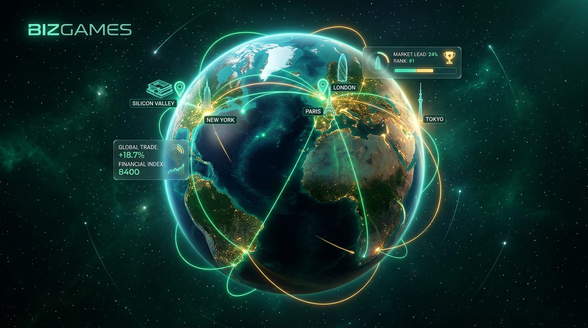

# 🌍 BizGames — Le Jeu Quotidien de Géographie Business



> **BizGames** est une application web interactive et gamifiée de géographie économique et business mondial. Chaque jour, les joueurs sont invités à localiser sur un globe 3D interactif ou une carte haute précision des sièges sociaux, des hubs d'innovation, des bourses financières et des zones économiques stratégiques.

🌐 **Application en production :** [https://bizgames-game.web.app](https://bizgames-game.web.app)  
📦 **Dépôt GitHub :** [https://github.com/segafal-spec/G-ostryke](https://github.com/segafal-spec/G-ostryke)

---

## 📌 1. Modèle & Philosophie du Projet

- **100 % Gratuit** : Tout le contenu (manche du jour, entraînement libre par secteur, archives, classements) est accessible à tous sans barrière payante.
- **Modèle économique** : Monétisation 100 % publicitaire (bannières non intrusives et annonces récompensées).
- **Compte joueur obligatoire** : Sauvegarde permanente du niveau, des scores, de la série de jours consécutifs (streak) et des statistiques.
- **PWA (Progressive Web App)** : Installable sur mobile (iOS / Android) et desktop avec support offline et notifications push.
- **Bilingue** : Interface nativement disponible en Français et en Anglais.

---

## 🎮 2. Fonctionnalités Principales

### 🕹️ Modes de Jeu
- **Manche Quotidienne (Daily)** : 5 questions par jour renouvelées automatiquement à minuit UTC, identiques pour tous les joueurs dans le monde.
- **Entraînement Libre** : Possibilité de s'entraîner par secteur d'activité (Tech & IA, Finance, Énergie, Luxe, Industrie, etc.).
- **Calcul de précision** : Formule géodésique (Haversine) calculant la distance au kilomètre près et attribuant jusqu'à 1 000 points par question avec bonus de temps.

### 🗺️ Visualisation Cartographique Hybride
- **Globe 3D interactif** : Rendu réaliste développé avec **Three.js** (shaders atmosphériques, nuages, textures haute résolution).
- **Carte 2D Vectorielle** : Moteur cartographique vectoriel haute performance propulsé par **MapLibre GL**.
- **Frontières et subdivisions** : Couches GeoJSON mondiales, départements français et états américains intégrés localement.

### 🏆 Social & Gamification
- **Classement mondial & mensuel** : Leaderboard en temps réel connecté à Cloud Firestore.
- **Profil & Badges** : Avatars personnalisables, système d'expérience (XP) et déblocage de succès.
- **Partage social** : Génération de fiches récapitulatives textuelles partageables sur WhatsApp, LinkedIn, X et Facebook.

### 🛡️ Espace d'Administration Complet (`/admin`)
- **Tableau de bord statistique** : DAU/MAU, parties jouées, taux de rétention, scores moyens.
- **Gestionnaire de questions** : Outil d'édition, filtrage et création de questions avec mini-carte Leaflet pour pointer directement les coordonnées GPS (latitude / longitude).
- **Validation & Calendrier** : Vue calendaire pour planifier les questions quotidiennes des semaines et mois à venir.
- **Gestion des joueurs & export** : Suivi des inscrits, gestion des rôles administrateurs et export sécurisé des contacts (format CSV).

---

## 🛠️ 3. Architecture & Technologies

| Domaine | Technologies |
| :--- | :--- |
| **Frontend** | React 18, Vite, Vanilla CSS moderne (Glassmorphism, Dark Luxury) |
| **Cartographie & 3D** | Three.js, MapLibre GL, Leaflet (admin), TopoJSON / GeoJSON |
| **Backend & Cloud** | Firebase Auth (Google & Email/Password), Cloud Firestore, Firebase Storage |
| **Hébergement** | Firebase Hosting avec CDN mondial Google |
| **Notifications & Audio** | Web Push / PWA Service Worker, Web Audio API |
| **Emails Transactionnels** | Service extensible (Resend / Brevo) |

---

## 📂 4. Arborescence du Projet

```text
BIZGAMES/
├── data/
│   └── questions.json            # Base de questions par défaut
├── public/
│   ├── audio/                    # Effets sonores (sons de clic, succès, erreur)
│   ├── data/                     # GeoJSON des frontières mondiales et états
│   ├── icons/                    # Icônes de l'application PWA
│   ├── images/                   # Avatars, bannières et textures 3D de la Terre
│   ├── manifest.json             # Manifeste PWA
│   └── sw.js                     # Service Worker PWA (mise en cache et notifications)
├── src/
│   ├── components/               # Composants React du jeu (Globe, Carte, Modales, Auth)
│   │   └── admin/                # Composants du panneau d'administration
│   ├── services/                 # Clients Firebase (Auth, Firestore, Storage) et Email
│   ├── utils/                    # Calculs géodésiques (Haversine), notifications, audio
│   ├── App.jsx                   # Point d'entrée principal et gestion des états globaux
│   ├── index.css                 # Système de design global et tokens CSS
│   └── main.jsx                  # Montage React DOM
├── context.md                    # Spécifications détaillées et source de vérité
├── GUIDE_GIT_MISES_A_JOUR.md     # Guide pas à pas pour les versions et Git
├── AGENTS.md / GEMINI.md         # Règles d'ingénierie et de déploiement
├── firebase.json                 # Configuration Firebase Hosting et règles
├── firestore.rules               # Règles de sécurité de la base de données Firestore
├── storage.rules                 # Règles de sécurité de stockage d'images
└── vite.config.js                # Configuration de compilation Vite
```

---

## 🚀 5. Installation et Démarrage Local

### Prérequis
- [Node.js](https://nodejs.org/) (version 18 ou supérieure)
- Un terminal (PowerShell, Bash, etc.)

### 1. Cloner le projet
```bash
git clone https://github.com/segafal-spec/G-ostryke.git
cd G-ostryke
```

### 2. Installer les dépendances
```bash
npm install
```

### 3. Configurer les variables d'environnement
Créez un fichier `.env` à la racine en vous basant sur `.env.example` :
```env
VITE_FIREBASE_API_KEY=votre_cle_api
VITE_FIREBASE_AUTH_DOMAIN=bizgames-game.firebaseapp.com
VITE_FIREBASE_PROJECT_ID=bizgames-game
VITE_FIREBASE_STORAGE_BUCKET=bizgames-game.appspot.com
VITE_FIREBASE_MESSAGING_SENDER_ID=votre_sender_id
VITE_FIREBASE_APP_ID=votre_app_id
```

### 4. Lancer le serveur de développement
```bash
npm run dev
```
L'application sera accessible sur `http://localhost:5173`.

---

## 📦 6. Compilation et Déploiement

### Compilation pour la production :
```bash
npm run build
```

### Déploiement sur Firebase Hosting :
```bash
firebase deploy --only hosting --non-interactive
```

---

## 📖 7. Documentation Complémentaire

- 📄 **[context.md](context.md)** : Spécifications fonctionnelles, schéma de base Firestore et règles métiers détaillées.
- 📘 **[GUIDE_GIT_MISES_A_JOUR.md](GUIDE_GIT_MISES_A_JOUR.md)** : Guide pratique pour créer une Version 2 (v2), gérer les branches et les versions de publication.

---

© 2026 BizGames — Tous droits réservés.
